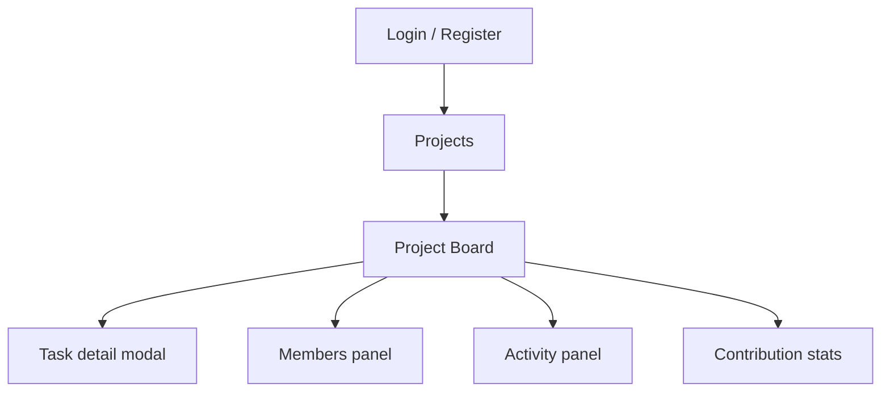

# TeamBoard site map and user flows

| Luồng | Thao tác | Trạng thái ngoại lệ |
| --- | --- | --- |
| Tạo project và mời bạn | Login → Projects → Create project → Board → Members → Copy join code. Bạn mở Projects → Join project → nhập mã → Board. | Tên trống, mã sai, chưa đăng nhập, không đủ quyền. |
| Tạo và hoàn thành task | Board → New task → nhập title và assignee → Save → To do → Doing → Review → Done → Refresh. | Title trống, người nhận ngoài project, lỗi lưu; giữ trạng thái trước đó và cho thử lại. |

## Storyboard

| Cảnh | Người dùng | Hành động | Điều hệ thống cho thấy |
| --- | --- | --- | --- |
| 1 | Trưởng nhóm | Tạo project và gửi join code | Project xuất hiện trong Projects |
| 2 | Thành viên | Tham gia bằng mã | Board và danh sách thành viên |
| 3 | Trưởng nhóm | Giao task và hạn chót | Task hiển thị trong To do với assignee |
| 4 | Thành viên | Hoàn thành và chuyển Done | Trạng thái mới được lưu |
| 5 | Nhóm | Mở Stats khi P1 đã có | Số task được giao, đã xong và bình luận theo người |

## Design tokens đề xuất

Font chính system-ui. Nền #F6F7FB, text #18243B, chính #334FC0, nhấn #D19000. Status có nhãn chữ và màu: To do #475569, Doing #1D4ED8, Review #854D0E, Done #166534. Khoảng cách 4 / 8 / 16 / 24 / 32 px, bo góc 8 / 14 px. Layout Board cuộn ngang trên mobile, thao tác Move có thể bấm thay cho kéo.
